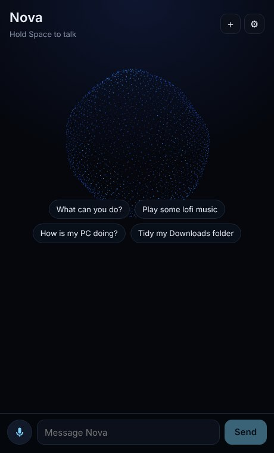
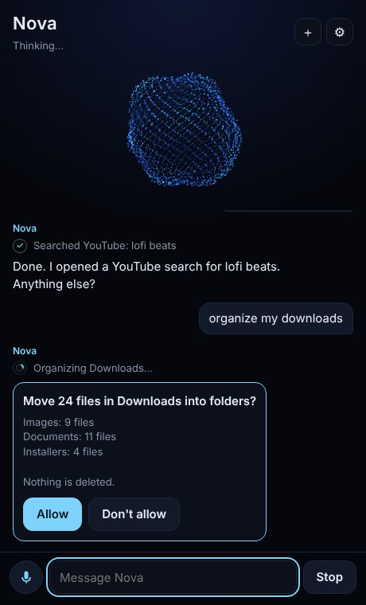
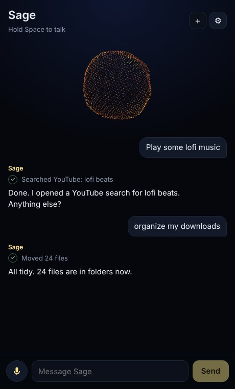
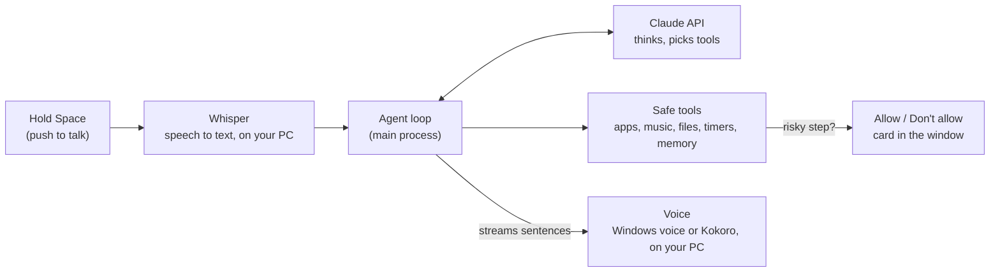

<div align="center">

# Nova

### A voice AI assistant for your Windows PC

Talk to it, and it answers out loud. It opens apps, finds music, checks your PC, tidies Downloads, sets reminders, searches the web and remembers what matters to you.

[](https://github.com/osamaayub/nova-assistant/actions/workflows/ci.yml)


[](LICENSE)





</div>

## What it can do

| Ask | What happens |
| --- | --- |
| "Open Spotify" / "Open VS Code" | Opens apps from a fixed, safe list (plus apps you add in Settings) |
| "Play some lofi music" | Opens a YouTube or Spotify search |
| "How is my PC doing?" | CPU, memory, disk space, battery and the busiest programs |
| "Tidy my Downloads folder" | Shows a plan, **asks you first**, then moves files into folders by type. Nothing is deleted |
| "Remind me in 20 minutes to stretch" | Windows notification, read out loud |
| "Who won the match last night?" | Searches the web and names its sources |
| "Remember that I prefer short answers" | Saved on your PC and used in every future chat (see and delete it in Settings) |

Pick a character (Nova, Sage the mentor, Max the friend, or write your own), and the orb changes colour and personality.

## How it works



1. **You speak.** Whisper turns your voice into text locally (no audio leaves your PC).
2. **Claude decides.** The agent loop sends your words, Nova's character and what it remembers. Claude either answers or asks to use a tool.
3. **Tools run safely.** Each tool checks its input with Zod. Anything that changes files asks you first. The loop stops after 8 steps.
4. **Nova speaks.** Replies stream in, and each sentence is spoken as soon as it is complete.

## Safety by design

- **No raw commands.** Claude picks an app *name*. The command for it is fixed in [`apps.ts`](src/main/agent/tools/apps.ts), so text like `cmd /c del *` can never run.
- **Your folders only.** File tools work inside Desktop, Documents, Downloads, Pictures, Music and Videos, and block `..` tricks.
- **Ask first.** Moving files needs your click on "Allow". Nothing is ever deleted or overwritten.
- **Your key is encrypted** with Windows (Electron `safeStorage`) and never reaches the window.
- **Locked-down window.** Sandboxed, context isolation, a tight Content Security Policy, and microphone is the only permission granted.

## Run it on Windows

You need [Node.js 22+](https://nodejs.org) and a [Claude API key](https://console.anthropic.com) (you pay Anthropic directly for what you use).

```bash
git clone https://github.com/osamaayub/nova-assistant.git
cd nova-assistant
npm install
npm run dev
```

Then click **Add API key**, paste your key, and hold **Space** to talk. **Alt+Space** shows or hides Nova from anywhere.

The first time you talk, Nova downloads the Whisper speech model (about 80 MB). If you pick the natural Kokoro voice, that downloads once too (about 90 MB). Both are cached after that.

**Make an installer:** `npm run build:win` creates `dist/nova-assistant-1.0.0-setup.exe`.

## Costs

Every message is a Claude API call. With **Sonnet 5.5** and short spoken replies, a typical command costs a fraction of a cent. **Haiku 5.5** is cheaper and faster, and **Opus 5.5** is smarter but slower. Web search adds $10 per 1,000 searches. You can turn it off in Settings.

## Project structure

```text
src/
├── main/                       # Node side: the agent and everything that touches your PC
│   ├── agent/
│   │   ├── loop.ts             # Claude tool-use loop: stream, run tools, step limit, history
│   │   ├── prompt.ts           # Characters and the system prompt
│   │   ├── service.ts          # One conversation: stop, new chat, "Allow?" questions, friendly errors
│   │   └── tools/              # apps, web, system, files, memory (each with a Zod schema)
│   ├── memory/store.ts         # Facts about you in SQLite (sql.js, no native install)
│   ├── settings/               # Settings file + encrypted API key
│   ├── platform.ts             # The real Windows actions (open, launch, notify)
│   └── index.ts                # Window, permissions, IPC, Alt+Space
├── preload/index.ts            # The only functions the window may call
├── renderer/src/               # The window (React)
│   ├── features/chat/          # Transcript, tool steps, Allow card
│   ├── features/voice/         # Push to talk, Whisper worker, Windows/Kokoro voices
│   ├── features/orb/Orb.tsx    # Three.js particle orb
│   └── features/settings/      # Key, model, character, voice, apps, memory
└── shared/types.ts             # Types both sides share
test/                           # Agent loop, tools, memory, settings, prompt (Vitest)
```

## Development

```bash
npm test            # 23 tests: agent loop, tool safety, memory, settings
npm run typecheck   # TypeScript (main and window)
npm run build:win   # Windows installer
```

## Ideas to build next

1. A wake word ("Hey Nova") with openWakeWord.
2. Calendar and email tools through MCP servers, with "Allow" on every send.
3. Move the agent into a FastAPI + LangGraph service so a web app can use the same brain.

## Author

Built by [Osama Ayub](https://github.com/osamaayub), full-stack developer (React, Next.js, Node.js, AI integration). Inspired by desktop assistants like JARVIS; all code and design here are original.

## License

[MIT](LICENSE)
