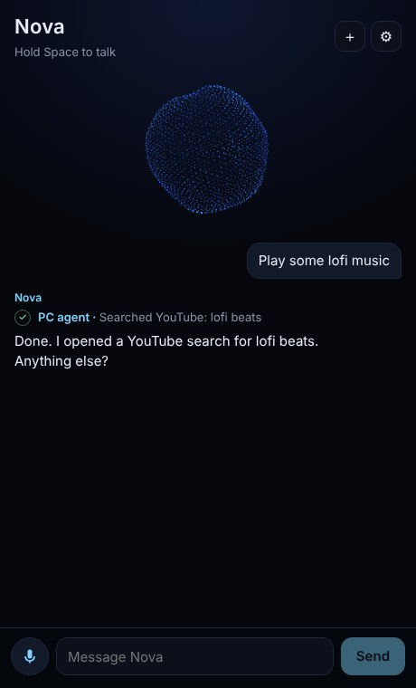
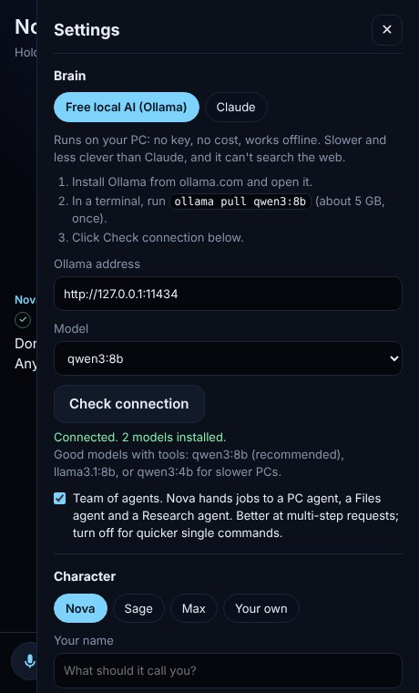
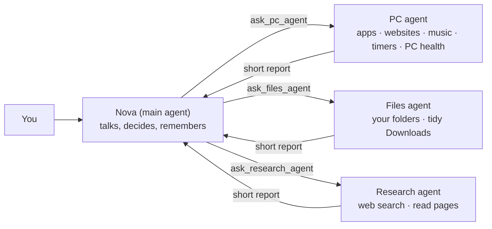
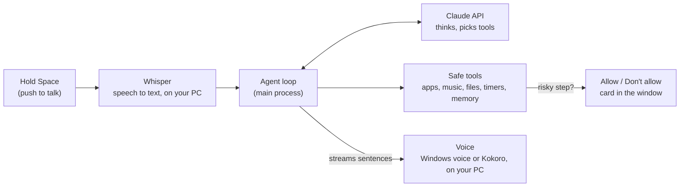

<div align="center">

# Nova

### A voice AI assistant for your Windows PC, run by a team of agents

Talk to it, and it answers out loud. It opens apps, finds music, checks your PC, tidies Downloads, sets reminders, researches and remembers what matters to you.

**Runs free on your own PC with Ollama (no API key), or on Claude.**

[](https://github.com/osamaayub/nova-assistant/actions/workflows/ci.yml)
[](https://github.com/osamaayub/nova-assistant/releases/latest)


[](LICENSE)





</div>

## What it can do

| Ask | What happens |
| --- | --- |
| "Open Spotify" / "Open VS Code" | Opens apps from a fixed, safe list (plus apps you add in Settings) |
| "Play some lofi music" | Opens a YouTube or Spotify search |
| "How is my PC doing?" | CPU, memory, disk space, battery and the busiest programs |
| "Tidy my Downloads folder" | Shows a plan, **asks you first**, then moves files into folders by type. Nothing is deleted |
| "Remind me in 20 minutes to stretch" | Windows notification, read out loud |
| "Who won the match last night?" | Searches the web and names its sources |
| "Remember that I prefer short answers" | Saved on your PC and used in every future chat (see and delete it in Settings) |

Pick a character (Nova, Jarvis the butler, Sage the mentor, Max the friend, or write your own), and the orb changes colour and personality. Nova keeps that character consistent in conversation and uses remembered details when they help.

## Two brains, your choice

| | Free local AI (default) | Claude |
| --- | --- | --- |
| Key needed | **No** | Your own Claude API key |
| Cost | Free | Pay per use |
| Runs | On your PC with [Ollama](https://ollama.com), works offline | Anthropic's servers |
| Web search | No (it can read a page whose address it knows) | Yes, with sources |
| Best model | `qwen3:8b` (about 5 GB, needs 8 GB+ RAM) | Sonnet 5.5 |

Switch any time in **Settings → Brain**.

## A team of agents

Like Claude Code's subagents, Nova splits work between specialists. The main agent talks to you and hands each job to the right one:



Each specialist sees only its task and its own tools, has a 6-step limit, and reports in one to three sentences what worked, the tool evidence, and any blockers. Nova passes relevant findings between specialists when tasks depend on each other, checks each report before continuing, and gives you one final answer. The window shows every step under the agent that ran it. Turn **Team of agents** off in Settings for quicker one-step commands.

## How it works



1. **You speak.** Whisper turns your voice into text locally (no audio leaves your PC).
2. **Claude decides.** The agent loop sends your words, Nova's character and what it remembers. Claude either answers or asks to use a tool.
3. **Tools run safely.** Each tool checks its input with Zod. Anything that changes files asks you first. The loop stops after 8 steps.
4. **Nova speaks.** Replies stream in, and each sentence is spoken as soon as it is complete.

## Safety by design

- **No raw commands.** Claude picks an app *name*. The command for it is fixed in [`apps.ts`](src/main/agent/tools/apps.ts), so text like `cmd /c del *` can never run.
- **Your folders only.** File tools work inside Desktop, Documents, Downloads, Pictures, Music and Videos, and block `..` tricks.
- **Ask first.** Moving files needs your click on "Allow". Nothing is ever deleted or overwritten.
- **Your key is encrypted** with Windows (Electron `safeStorage`) and never reaches the window.
- **Locked-down window.** Sandboxed, context isolation, a tight Content Security Policy, and microphone is the only permission granted.

## Download

Get the latest **Windows installer** from [Releases](https://github.com/osamaayub/nova-assistant/releases/latest), run it, and add your Claude API key in Settings. The installer isn't code-signed yet, so Windows may say "Windows protected your PC": click **More info**, then **Run anyway**.

## Free setup (no key)

1. Install [Ollama](https://ollama.com) and open it.
2. In a terminal: `ollama pull qwen3:8b`
3. Install Nova, open **Settings → Brain**, keep **Free local AI**, and click **Check connection**.

## Run it from the code

You need [Node.js 22+](https://nodejs.org), plus Ollama (free) or a [Claude API key](https://console.anthropic.com).

```bash
git clone https://github.com/osamaayub/nova-assistant.git
cd nova-assistant
npm install
npm run dev
```

Then hold **Space** to talk. **Alt+Space** shows or hides Nova from anywhere.

The first time you talk, Nova downloads the Whisper speech model (about 80 MB). If you pick the natural Kokoro voice, that downloads once too (about 90 MB). Both are cached after that.

**Make an installer:** `npm run build:win` creates `dist/nova-assistant-1.0.0-setup.exe`. The Release workflow does this on GitHub and attaches it to a release.

## Costs

With Ollama, Nova is completely free. With Claude, every message is an API call, and team mode makes a few calls per request. With **Sonnet 5.5** and short spoken replies, a typical command costs a fraction of a cent. **Haiku 5.5** is cheaper and faster, and **Opus 5.5** is smarter but slower. Web search adds $10 per 1,000 searches. You can turn it off in Settings.

## Project structure

```text
src/
├── main/                       # Node side: the agent and everything that touches your PC
│   ├── agent/
│   │   ├── loop.ts             # The agent loop for any brain: stream, run tools, step limit, history
│   │   ├── team.ts             # The team: PC, Files and Research specialists and their hand-over tools
│   │   ├── providers/          # claude.ts (tool use + web search), ollama.ts (free, local)
│   │   ├── types.ts            # Nova's own message format and the Provider interface
│   │   ├── prompt.ts           # Characters and the system prompt
│   │   ├── service.ts          # One conversation: picks the brain, runs the team, "Allow?" questions
│   │   └── tools/              # apps, web, system, files, memory (each with a Zod schema)
│   ├── memory/store.ts         # Facts about you in SQLite (sql.js, no native install)
│   ├── settings/               # Settings file + encrypted API key
│   ├── platform.ts             # The real Windows actions (open, launch, notify)
│   └── index.ts                # Window, permissions, IPC, Alt+Space
├── preload/index.ts            # The only functions the window may call
├── renderer/src/               # The window (React)
│   ├── features/chat/          # Transcript, tool steps, Allow card
│   ├── features/voice/         # Push to talk, Whisper worker, Windows/Kokoro voices
│   ├── features/orb/Orb.tsx    # Three.js particle orb
│   └── features/settings/      # Key, model, character, voice, apps, memory
└── shared/types.ts             # Types both sides share
test/                           # Agent loop, tools, memory, settings, prompt (Vitest)
```

## Development

```bash
npm test            # 36 tests: agent loop, both brains, the team, tool safety, memory
npm run typecheck   # TypeScript (main and window)
npm run build:win   # Windows installer
```

## Built by a team of agents, too

Like JS Mastery's Askwell, this repo is set up for a team of AI coding agents: [`CLAUDE.md`](CLAUDE.md) holds the team rules, [`docs/project.md`](docs/project.md) says what to build and [`docs/plan.md`](docs/plan.md) gives the phases, each split into two parallel lanes.

Phase 3 is in: a "Hey Nova" wake word (Settings → Always on), a system tray with start-with-Windows, and MCP connectors for calendar, email and other apps (Settings → Connectors; anything that changes data asks you first).

Next on the plan: a shared FastAPI + LangGraph brain service.

## Author

Built by [Osama Ayub](https://github.com/osamaayub), full-stack developer (React, Next.js, Node.js, AI integration). Inspired by desktop assistants like JARVIS; all code and design here are original.

## License

[MIT](LICENSE)
