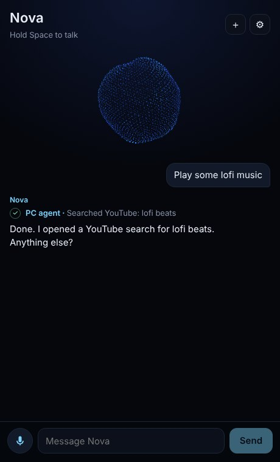
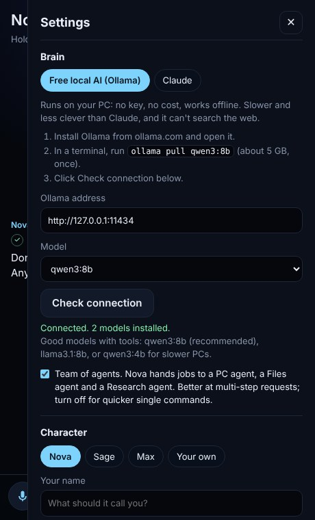
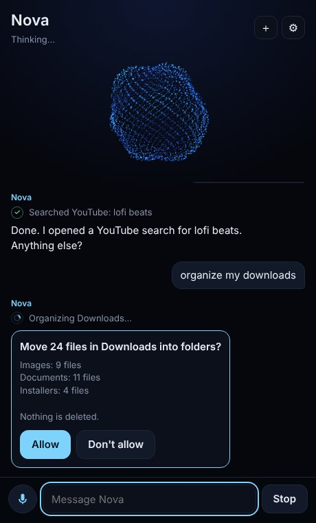
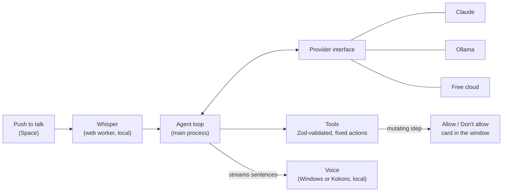
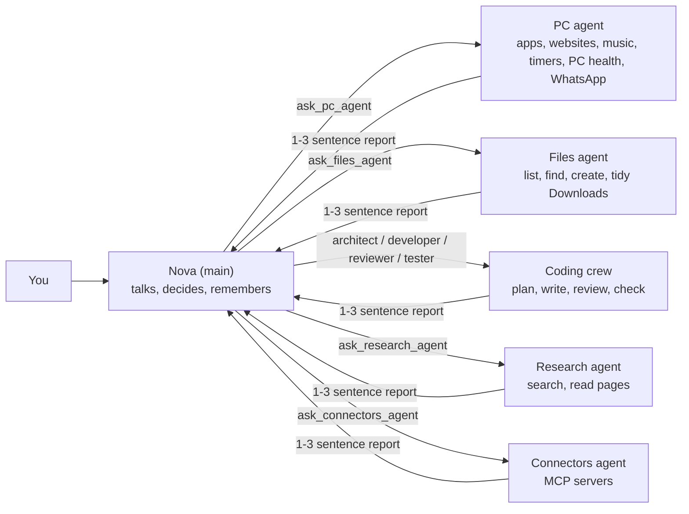
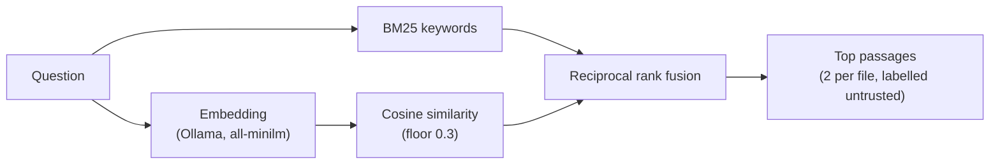

<div align="center">

# Nova

### A voice assistant for Windows, run by a team of narrow, safety-bounded agents

Hold a key, speak, and Nova answers out loud and acts on your PC: opens apps, tidies folders, sets reminders, researches the web, works on code, and talks to MCP tools. The model is swappable: **Ollama on your PC, a free hosted model, or Claude.**

[](https://github.com/osamaayub/nova-assistant/actions/workflows/ci.yml)
[](https://github.com/osamaayub/nova-assistant/releases/latest)


[](LICENSE)





</div>

## Contents

[Why Nova](#why-nova) · [Quick start](#quick-start) · [Architecture](#architecture) · [Agent design](#agent-design) · [Security model](#security-model) · [Brains](#brains) · [Web preview](#web-preview-vercel) · [Fine-tuning](#fine-tuning-experimental) · [Development](#development) · [Limitations](#limitations-and-roadmap)

## Why Nova

Most desktop assistants are either a chat box with no hands, or an agent with too many. Nova is built around three constraints:

| Constraint | What it means in practice |
| --- | --- |
| **Works with no paid service** | Default brain is a local Ollama model. Cloud brains are optional. |
| **The model never gets a shell** | Tools run fixed actions. The model chooses a tool name and validated values, never a command or an arbitrary path. |
| **Nothing destructive, ever** | Anything that moves, writes or sends asks for an explicit Allow click. No tool deletes or overwrites. |

## Quick start

**Use it:** download the installer from [Releases](https://github.com/osamaayub/nova-assistant/releases/latest). It is not code-signed yet, so Windows SmartScreen will warn: choose *More info*, then *Run anyway*. Pick a brain in **Settings → Brain**.

**Run from source** (Windows, [Node.js 22](https://nodejs.org), the version CI uses):

```bash
git clone https://github.com/osamaayub/nova-assistant.git
cd nova-assistant
npm install
npm run dev
```

Hold **Space** to talk. **Alt+Space** shows or hides Nova. On first use Nova downloads the Whisper model (about 80 MB), and the Kokoro voice (about 90 MB) if you choose it. Both are cached.

**Pick a free brain:**

| Option | Setup | Notes |
| --- | --- | --- |
| Free cloud | Select it in Settings → Brain | No key, rate-limited, chats leave your PC |
| Ollama | Install [Ollama](https://ollama.com), `ollama pull qwen3:8b`, click *Check connection* | Private and offline. `qwen3:8b` wants 8 GB+ free RAM. On a smaller or GPU-less machine try a 3B model such as `qwen2.5:3b` |
| Claude | Paste your own API key in Settings | Strongest, adds web search with sources |

## What it does

| Say | Result |
| --- | --- |
| "Open Spotify" | Launches from a fixed list (plus apps you add in Settings) |
| "Play some lofi" | Opens the top YouTube result, or a Spotify search |
| "How is my PC doing?" | CPU, memory, disk, battery, busiest programs |
| "Tidy my Downloads" | Shows a plan, asks first, then sorts files into folders by type |
| "Remind me in 20 minutes to stretch" | Windows notification, read aloud |
| "Write a parser for this CSV" | Coding crew: plan, write (after Allow), review, run fixed checks |
| "What's on my calendar?" | MCP connectors, with approval for anything that changes data |
| "What did I write about the Lahore trip?" | Searches inside your notes and documents and names the file each answer came from |
| "Remember that I prefer short answers" | Saved locally, recalled when relevant, editable in Settings |

Also included: four characters plus a custom one, a command-center view with a live crew board, a phone link over your Wi-Fi, wake word, and start with Windows.

## Architecture



The window is a sandboxed React app that can only call the functions exposed in `src/preload`. Everything that touches the PC lives in the main process. Audio never leaves the machine: speech-to-text and the Kokoro voice both run locally.

### Key design decisions

| Decision | Why | Trade-off |
| --- | --- | --- |
| **One `Provider` interface** (`src/main/agent/types.ts`). The loop and the team never import a provider directly. | Swap brains without touching agent logic. Tests run on a fake provider. | Provider quirks are absorbed in each adapter (for example, Ollama models that print a tool call as text are parsed back into one). |
| **One neutral message format (`Msg`).** Anthropic and Ollama shapes never leave `providers/`. | History survives switching brains mid-conversation. | A conversion layer to maintain per provider. |
| **Zod schema is the single source of truth for a tool.** The JSON schema sent to the model is generated from it, and the same schema validates the model's arguments. | Prompt and validation cannot drift apart. | Tools are limited to what Zod can express. |
| **Specialists get only their own tools and a fresh, short conversation.** They never hand work to each other. | Small tool lists suit small models, and a mistaken specialist has a small blast radius. | The main agent must write a self-contained task each time. |
| **Sandboxed renderer, typed IPC.** No new channel without a type in `src/shared/types.ts`. | The window cannot reach Node or the file system. | More ceremony for each new capability. |
| **sql.js for memory.** | No native module to rebuild per Electron version. | Whole-database writes, fine at this scale. |

## Agent design

A turn is a bounded loop: call the model, run the tools it asked for, feed results back, repeat until it answers or hits the step limit.



| Rule | Detail |
| --- | --- |
| Step limits | 8 for the main agent, 6 per specialist |
| Handoff contract | A specialist sees only its task, so the main agent includes intent, constraints and findings it depends on |
| Reports | One to three sentences: what was done, tool evidence, blockers. The main agent never claims success a report does not confirm |
| Parallelism | Independent jobs go to their specialists in the same reply |
| Coding crew | Run in order: Architect (read-only plan), Developer (writes after Allow), Reviewer (read-only), Tester (fixed checks after Allow) |
| Single mode | Turn **Team of agents** off and one agent gets every tool, which is faster for simple commands |

Memory is a set of short third-person facts in SQLite. Per message, only the relevant ones are recalled into the prompt. Nova is told never to store secrets, and the tool rejects text that looks like a password or card number.

## Retrieval (RAG)

Nova retrieves from two sources, both local and both read-only.

| Source | How it is found | Where it is used |
| --- | --- | --- |
| **Your documents** | Text, markdown, CSV and code files in Documents and Desktop are split into passages and indexed in SQLite (`nova-docs.sqlite`). | The Files agent's `search_documents` tool, for "what did I write about X" questions. |
| **Your memories** | Remembered facts are matched to each message by keywords and by meaning. | Every reply: the most relevant facts go into the prompt. |



| Detail | Behaviour |
| --- | --- |
| Hybrid search | BM25 finds exact words and names. Embeddings find the same idea in different words ("what should I cook tonight" finds "I am vegetarian"). Rank fusion merges them without comparing their different score scales. |
| Embeddings | From your own Ollama with the small `all-minilm` model (about 45 MB): `ollama pull all-minilm`. No key, nothing sent to a cloud service. |
| Graceful fallback | No Ollama or no model: both sources fall back to keywords and the tool says how to improve it. Failures back off for a minute, so a missing model costs nothing per message. |
| Fresh index | The first search scans the folders, then re-scans at most every 5 minutes. Only new, changed and deleted files are re-read. Vectors are stored, and recomputed if the embedding model changes. |
| Limits | 1,500 files, 1 MB each, 5 folders deep, 20,000 passages, 15 second scan budget. Memory recall waits at most 2.5 seconds for the embedder, then uses keywords. |
| Not indexed | PDF and Word (they need a parser), hidden folders, `node_modules`, build output, symbolic links, binary files, and files that look like secrets (`.env`, `*.pem`, `*.key`, names containing password, secret, credential or token). |

Privacy: the index never leaves your PC, but **the passages the model reads are sent to your brain**. With Ollama that stays on your machine. With Claude or the free cloud, the passages it retrieves for a question leave your PC like the rest of the chat. Pick Ollama if your notes are private.

## Security model

| Threat | Mitigation | Residual risk |
| --- | --- | --- |
| Model output run as a command | No tool takes a command. Apps map to fixed launch targets in `apps.ts`; checks are a fixed list (`npm test`, `npm run typecheck`, `npm run lint`, `python -m pytest`). | None by design. A new tool is a code change, reviewed by a human. |
| Path traversal and file damage | File tools are confined to Desktop, Documents, Downloads, Pictures, Music and Videos, reject `..`, and never delete or overwrite (name collisions get a new name). | Moving files within those folders after approval. |
| Surprise side effects | Moving, writing, sending and running checks call `ctx.confirm()`. Declining is reported back to the model. | Users can click Allow without reading. |
| SSRF through web tools | `read_web_page` checks every address before requesting it, including each redirect (followed by hand, 5 at most, no https to http). It rejects private, loopback, link-local and reserved ranges in IPv4 and IPv6, IPv4 hidden in IPv6, tricks like `2130706433` or `localhost.`, and names that resolve to a private address. It allows only ports 80, 443, 8080 and 8443, refuses `user:pass@` addresses, and stops downloading after 2 MB. | The name is resolved once to check it and again when the request connects, so a server that changes its DNS answer in between could still slip through. |
| Documents leaking through search | Read-only, limited to Documents and Desktop, no links followed, secret-looking files and folders skipped, results capped (5 passages, 2 per file, 700 characters each). | With Claude or free cloud, retrieved passages are sent to that service. Use Ollama for private notes. |
| Prompt injection from documents | Passages are returned labelled as untrusted data, the Files agent cannot move or write anything on a retrieved instruction without an Allow click, and Nova is told never to follow instructions found in them. | A model can still be misled in what it says. |
| Prompt injection from web pages | Page text is returned labelled as untrusted data, and the Research agent has no tool that changes anything. | A model can still be misled in what it says. In single-agent mode, every change-making tool still needs an Allow click. |
| API key theft | Stored with Electron `safeStorage` (Windows DPAPI), never sent to the window. | Anyone logged in as the same Windows user. |
| Compromised or XSS window | Sandbox, context isolation, strict CSP in the app, microphone as the only permission, preload exposes a fixed API. | Bugs in Electron or Chromium. |
| Third-party MCP servers | Run as separate processes. Read-only tools run freely, anything else asks first. Remote MCP goes through a pinned `mcp-remote` bridge. | You are trusting the server you connect. |
| Phone link | Off by default. Pairing address carries a secret token, compared by digest, and only four actions are accepted. Rotating the token disconnects paired phones. | Anyone who has the pairing address can use it. Keep it private. |
| Privacy | Whisper and Kokoro run locally. With Ollama nothing leaves the PC. | Free cloud and Claude send your chat text to a remote service. |

Found a vulnerability? Please contact the author through the GitHub profile below rather than opening a public issue.

## Brains

| | Ollama (default) | Free cloud | Claude |
| --- | --- | --- | --- |
| Key | None | None | Your API key |
| Cost | Free | Free, rate-limited | Pay per use |
| Runs | Your PC, offline | Hosted at `api.jarvisclaw.ai` (third party, can disappear) | Anthropic |
| Web search | No (can read a page by address) | No | Yes, with sources |
| Models | `qwen3:8b` default | `auto/free` | Haiku 5.5, Sonnet 5.5, Opus 5.5 |

With Claude, every message is an API call and team mode makes a few per request. Short spoken replies on Sonnet 5.5 typically cost a fraction of a cent per command. Web search adds $10 per 1,000 searches and can be turned off.

## Web preview (Vercel)

The renderer also builds as a static site (`vercel.json`, output `out/renderer`) for design review and demos. It is **not** the product: there is no main process, so PC tools do not exist in a browser.

| In the browser | Behaviour |
| --- | --- |
| Chat | Streams directly from your local Ollama over HTTP |
| Everything else | Stubs (headlines, file results and similar are fake) |

To chat from the hosted page, Ollama must allow that origin. The error message shows the exact value to use:

```powershell
setx OLLAMA_ORIGINS "https://<your-site>.vercel.app"   # then restart Ollama
```

Chrome may also ask for local network access: choose Allow. The web build adds `localhost` to its CSP (`electron.vite.config.ts`, only when `VERCEL` is set); the desktop app keeps the strict policy.

## Fine-tuning (experimental)

[`training/`](training/) contains a pipeline that fine-tunes a small open model (Qwen2.5 3B, QLoRA) to be a better team-mode main agent: choose the right specialist, write self-contained tasks, parallelize independent work, ask when information is missing, and keep replies short and spoken.

| Piece | File |
| --- | --- |
| Synthetic data from the real system prompt and tool text | `training/build_dataset.py` |
| QLoRA training and GGUF export (run on a free Colab T4) | `training/train.py` |
| Held-out routing score, base vs tuned | `training/eval_routing.py` |

Status: the run has been started but not yet evaluated. A tuned model should only be adopted if it beats the base model on `eval_routing.py`. The data is synthetic, so it teaches format and routing rather than new knowledge. Steps and caveats are in [`training/README.md`](training/README.md).

## Development

| Command | Does |
| --- | --- |
| `npm run dev` | App with hot reload |
| `npm test` | Vitest: agent loop, providers, team, tool safety, MCP, memory, remote |
| `npm run typecheck` | TypeScript for main and window |
| `npm run lint` | ESLint |
| `npm run build:win` | Windows installer in `dist/` |

Tests use fake providers, a fake platform and a fake web, so they need no network and no Windows APIs. Voice, app launching and the installer are verified by hand on a real PC.

### CI/CD

| Workflow | File | When | Does |
| --- | --- | --- | --- |
| **CI** | `ci.yml` | Every PR and push to `main` | Runs Lint, Typecheck, Unit tests (Windows) and Build (desktop and web) in parallel. Also checks the desktop CSP stays strict and the web one allows local Ollama. Branch protection needs only **CI passed**. |
| **CD - Release Windows installer** | `cd-release.yml` | Run workflow on `main`, or push a `v*` tag | **Verify** (runs CI), then **Build installer** (read-only token), then **Publish GitHub Release** (the only job that can write). Attaches the installer and `SHA256SUMS.txt`. A tag that does not match `package.json` stops the run. |
| **Security audit** | `security-audit.yml` | Weekly, on demand, when the lockfile changes | `npm audit` on production dependencies. |
| Dependabot | `dependabot.yml` | Weekly | Grouped update PRs for npm and GitHub Actions. |

The web preview deploys through Vercel's Git integration, not a workflow here. The Node version for every job comes from `.nvmrc`.

<details>
<summary><b>Project structure</b></summary>

```text
src/
├── main/                      # Node: the agent and everything that touches the PC
│   ├── agent/
│   │   ├── loop.ts            # Bounded tool loop for any provider
│   │   ├── team.ts            # Specialists and the main agent's hand-over tools
│   │   ├── prompt.ts          # Characters and system prompt
│   │   ├── memory-recall.ts   # Picks which facts go into a prompt
│   │   ├── service.ts         # One conversation: brain, team, Allow questions
│   │   ├── providers/         # claude.ts, ollama.ts, flm.ts (free cloud)
│   │   └── tools/             # apps, web, system, files, memory, code, mcp
│   ├── mcp/                   # MCP client and connector manager
│   ├── rag/                   # Document index (SQLite), BM25, embeddings, rank fusion
│   ├── remote/                # Phone link server and tunnel
│   ├── memory/store.ts        # Facts in SQLite (sql.js)
│   ├── settings/              # Settings file and encrypted key
│   └── platform.ts            # The real Windows actions
├── preload/index.ts           # The only functions the window may call
├── renderer/src/              # React window: chat, crew, command center, voice, settings
└── shared/types.ts            # Contracts shared by both sides
test/                          # Vitest suites
training/                      # Fine-tuning pipeline (experimental)
docs/                          # project.md (what), plan.md (order), screenshots
```

</details>

### Adding a tool

1. Define it in `src/main/agent/tools/` with `defineTool`: a name, a Zod schema, and a `run` that performs a fixed action. Validate and confine every path or URL it touches.
2. If it moves, sends, writes or spends, call `ctx.confirm()` before acting. Never add a tool that deletes.
3. Give it to exactly one specialist in `team.ts` (and to `TOOLS` in `tools/index.ts` for single mode).
4. Add a test with the fake platform, including the declined path.
5. If you changed tool names or descriptions, update `training/build_dataset.py` and retrain.

A tool that changes user data, sends messages or spends money needs the owner's approval first. See [`CLAUDE.md`](CLAUDE.md).

### Adding a brain

Implement `Provider` in `src/main/agent/providers/`, convert to and from `Msg` inside it, and register it in `service.ts`. Nothing else should import it.

## Limitations and roadmap

| Area | Today |
| --- | --- |
| Platform | Windows only. App launching and WhatsApp send use Windows-specific code. |
| Distribution | Installer is unsigned. |
| Small local models | Tool calling is the weak spot (see Fine-tuning). Free CPU-only machines can be slow with 3B+ models. |
| Document search | Plain-text files only (no PDF or Word yet). Search by meaning needs Ollama with `all-minilm`; otherwise keywords only. |
| Ollama web search | Not available. Claude only. |
| Free cloud | Depends on a third-party service. |
| Tests | Voice, app launching and the installer are manual checks. |

Next (see [`docs/plan.md`](docs/plan.md)): a shared brain service (FastAPI and LangGraph with vector memory) so the desktop and a web client continue the same conversation.

## How this repo is built

It is set up for a team of AI coding agents working in parallel lanes: [`CLAUDE.md`](CLAUDE.md) holds the rules (architecture constraints, when to stop and ask, never push to `main`), [`docs/project.md`](docs/project.md) is the spec, and [`docs/plan.md`](docs/plan.md) is the build order.

## Author

[Osama Ayub](https://github.com/osamaayub), full-stack developer (React, Next.js, Node.js, AI integration). Inspired by film-style desktop assistants. All code and design here are original.

## License

[MIT](LICENSE)
